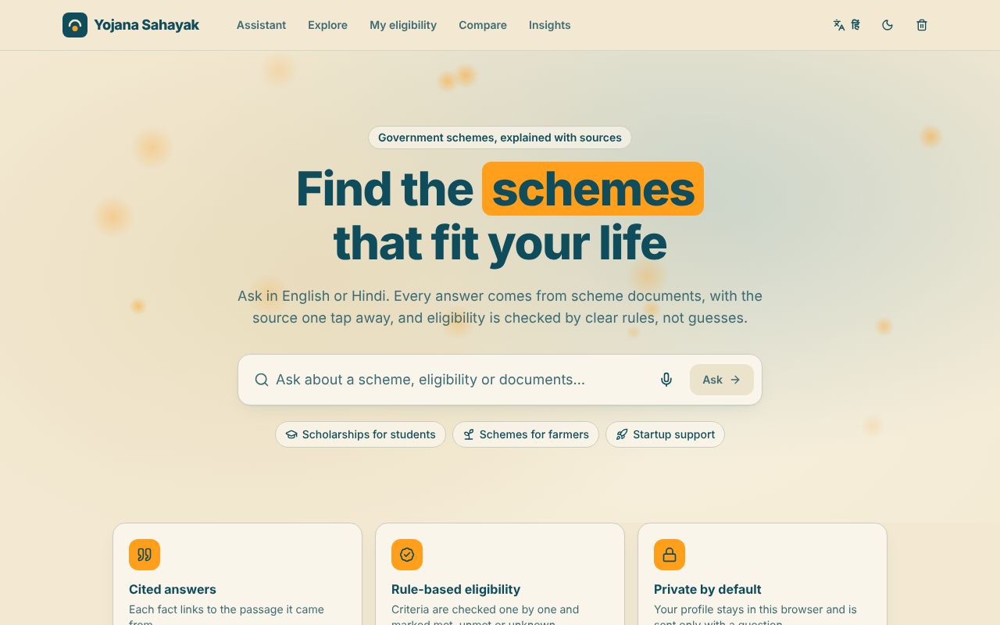
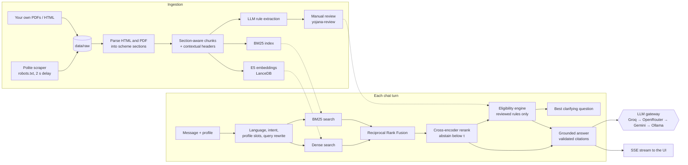
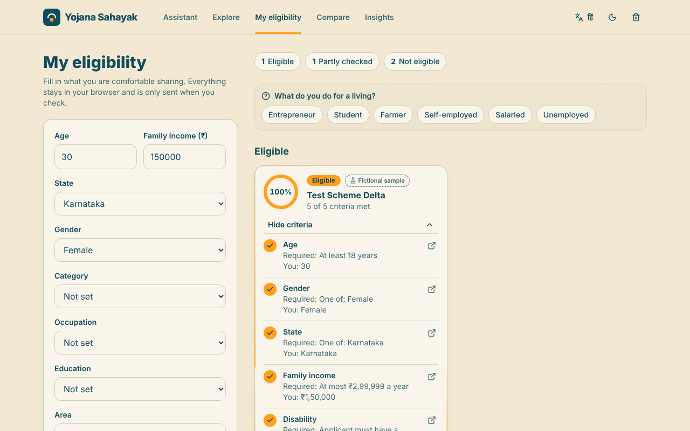

# Yojana Sahayak

Yojana Sahayak helps people in India find government welfare schemes (scholarships,
farmer support, startup support, schemes for women, students and persons with
disabilities), check whether they qualify, and see exactly which documents to collect.
You can ask in English or Hindi. Every answer is built from retrieved scheme documents
with inline citations, eligibility is decided by a rule engine rather than a language
model, and the assistant asks a follow-up question when it is missing a detail
instead of guessing.



## How it works



Every stage of a turn is streamed to the browser as server-sent events, and the UI's
progress tracker is driven by those events.

## Features

- **Citation-first answers.** Answers may only use the numbered passages in the
  prompt. Citations that point at no passage are removed while tokens are still
  streaming. In the UI, each `[n]` chip previews its passage on hover and opens a
  drawer with the full chunk and the cited sentence highlighted.
- **Hybrid retrieval.** Multilingual E5 embeddings and BM25 run with the same
  state/category filters, results are fused with Reciprocal Rank Fusion, and the top 20
  are reranked by a multilingual cross-encoder. When the best rerank score is below the
  calibrated threshold, the assistant says it could not find the answer.
- **Deterministic eligibility.** Rules such as age, income, category, occupation,
  education, state, disability and residence are evaluated in Python. Each criterion is
  met, unmet or unknown and links to the passage that states it. Free-text conditions
  are listed for the user to check themselves.
- **Clarifying questions.** When criteria are unknown, the assistant asks for the single
  profile field that settles the most schemes, with quick replies. Income options use the
  income limits of the schemes still in play as bucket edges.
- **LLM gateway with failover.** Providers are tried in order, with proactive budgets,
  rate-limit cooldowns from response headers, permanent disabling on 401/402/403, one
  retry for timeouts and 5xx, mid-stream provider switching, a SQLite response cache, and
  privacy routing that keeps profile-bearing requests away from providers that train on
  free-tier data.
- **Works when providers are down.** Profile slots fall back to regular expressions,
  intent to keyword rules, and answers to quoted source passages.
- **MCP server.** Search, scheme details, eligibility and document lists are exposed as
  MCP tools that call no language model.
- **Evaluation harness.** Recall@k, MRR, nDCG@5, faithfulness judged by a second
  provider, citation precision, abstention accuracy, latency, and five retrieval
  ablations.
- **Frontend.** Bilingual UI with light and dark themes, voice input and read-aloud
  through the browser, a scheme explorer, a printable document checklist, a comparison
  view and an evaluation dashboard. It respects `prefers-reduced-motion` and works from
  360 px phones upward.



## Tech stack

| Area | Tools |
|---|---|
| API | FastAPI, Uvicorn, Pydantic v2, pydantic-settings |
| Retrieval | sentence-transformers (CPU), `intfloat/multilingual-e5-small`, `cross-encoder/mmarco-mMiniLMv2-L12-H384-v1`, LanceDB, rank-bm25 |
| Ingestion | httpx, BeautifulSoup, PyMuPDF, optional Playwright for JavaScript-rendered pages |
| LLMs | `openai` SDK against OpenAI-compatible endpoints, tiktoken, SQLite for usage and cache |
| MCP | official `mcp` Python SDK (`MCPServer`, the 2.x name of FastMCP) |
| Frontend | Vite, React 19, TypeScript, Tailwind CSS 4, Framer Motion, TanStack Query, Recharts, lucide-react |
| Quality | pytest, respx, ruff, ESLint, Prettier, GitHub Actions |

## Setup on Windows

Requirements: Python 3.11+ (developed on 3.13), the current Node.js LTS, and Git. No GPU
is needed. Everything runs on a CPU laptop with 8–16 GB of RAM.

```powershell
git clone <your fork url> yojana-sahayak
cd yojana-sahayak
powershell -ExecutionPolicy Bypass -File scripts\setup.ps1
```

`setup.ps1` creates `.venv`, installs the CPU-only PyTorch wheel and the backend (with
dev tools), runs `npm ci` for the frontend, and copies `.env.example` to `.env`.

Optional flags:

- `-Onnx` installs ONNX Runtime. Then set `backend: onnx` under `embedding` and
  `reranker` in `config/retrieval.yaml` for faster CPU inference.
- `-Render` installs Playwright and Chromium for pages that only render with JavaScript
  (myScheme pages are like this).

The two models download from Hugging Face on first use, roughly 470 MB each, into
`data/cache/models`.

## Free API keys

Put the keys you have in `.env`. Every provider is optional. Order and limits live in
`config/providers.yaml`.

| Provider | Where to get a key | Notes |
|---|---|---|
| Groq | <https://console.groq.com/keys> | First choice: fast, generous free tier. |
| OpenRouter | <https://openrouter.ai/keys> | Only `:free` model variants are configured. The free roster changes, so update the model id if it disappears. |
| Gemini | <https://aistudio.google.com/apikey> | Free-tier prompts may be used to improve Google's products, so requests that carry your profile are never sent here. |
| GitHub Models | n/a | GitHub retired this API on 2026-07-30. The entry is kept, disabled, as a slot for another OpenAI-compatible endpoint. |
| Ollama | none | Local, offline last resort. Set `OLLAMA_MODEL` to a model you have pulled; the default is `gemma3:4b`. |

The limits in `providers.yaml` are the published free-tier numbers. If your account
shows lower ones, lower them there, because budgets are checked before each call.

## Ingesting data

```powershell
# Fictional sample set (four invented schemes) to try everything offline
scripts\ingest.ps1 -Sample

# Scrape public pages listed in config\sources.yaml, then extract eligibility rules
scripts\ingest.ps1 -Scrape -MaxPages 20 -Rules
```

- **Your own files.** Drop PDFs or HTML files anywhere under `data\raw\` and run
  `scripts\ingest.ps1` again; only new or changed files are processed. A
  `<file>.meta.yaml` next to a file can set `scheme_id`, `scheme_name`, `ministry`,
  `state`, `category` and `source_url` when they cannot be inferred.
- **Reviewing rules.** Extracted eligibility rules are saved with `needs_review: true`,
  and the engine ignores them until you review them:

  ```powershell
  .venv\Scripts\yojana-review interactive        # step through pending schemes
  .venv\Scripts\yojana-review show <scheme_id>   # rules with their source passages
  .venv\Scripts\yojana-review set <scheme_id> max_age 35
  .venv\Scripts\yojana-review approve <scheme_id>
  ```

  To try unreviewed rules anyway, set `YOJANA_ALLOW_UNREVIEWED_RULES=true`; the UI marks
  them as not yet reviewed.

The scraper reads robots.txt before touching a host and follows it, including
`Crawl-delay`. It waits at least two seconds between requests and sends an identifying
User-Agent. Every saved file is recorded with its source URL in `data\raw\manifest.jsonl`.

## Running

```powershell
scripts\dev.ps1
```

This starts the API on <http://127.0.0.1:8000> (interactive docs at `/docs`) and the
frontend on <http://localhost:5173>. The models warm up in the background at startup.

| Endpoint | Purpose |
|---|---|
| `POST /api/chat` | Streams `stage`, `token`, `citations`, `eligibility`, `clarify`, `provider`, `provider_switch`, `error` and `done` events |
| `GET /api/schemes` | Filter by `state`, `category`, `q`; paginated |
| `GET /api/schemes/{id}` | Sections, rules with sources, checklist |
| `GET /api/schemes/{id}/checklist` | Documents required, each with its citation |
| `POST /api/eligibility` | Profile → eligible / partial / ineligible with per-criterion breakdown |
| `GET /api/eval/latest` | Latest evaluation report |
| `GET /api/health/providers` | Each provider's status and today's usage |
| `POST /api/admin/ingest` | Incremental ingestion; accepted from localhost only |

Your profile stays in the browser's `localStorage` and is sent only with each request.
**Clear my data** in the header removes it. Logs are JSON with request ids and never
contain profile values or message text at INFO level.

## MCP usage

```powershell
scripts\mcp.ps1               # run the stdio server
scripts\mcp.ps1 -PrintConfig  # print a Claude Desktop entry with your paths
```

Add the printed block to `%APPDATA%\Claude\claude_desktop_config.json`. It looks like
this:

```json
{
  "mcpServers": {
    "yojana-sahayak": {
      "command": "D:\\Yojana\\.venv\\Scripts\\python.exe",
      "args": ["-m", "yojana.mcp_server"],
      "env": { "YOJANA_ROOT": "D:\\Yojana" }
    }
  }
}
```

The tools are `search_schemes(query, state?, category?, top_k?)`,
`get_scheme_details(scheme_id)`, `check_eligibility(profile, scheme_ids?)` and
`list_required_documents(scheme_id)`. None of them calls an LLM.

## Evaluation

```powershell
scripts\eval.ps1 -Sample     # questions about the fictional sample set
scripts\eval.ps1             # your verified questions in data\eval\golden.jsonl
```

Reports go to `reports\eval-<timestamp>.json` and `.md`, and the Insights page shows the
latest one. The LLM response cache is on during evaluation, so reruns cost no quota.

**Golden questions.** `data/eval/golden.jsonl` starts empty on purpose. To add
questions:

```powershell
.venv\Scripts\python -m yojana.eval.bootstrap propose --n 20   # candidates from random chunks
.venv\Scripts\python -m yojana.eval.bootstrap verify           # accept, edit or reject each
```

Only accepted questions are written to `golden.jsonl`, marked `verified: true`. The
format is in `data/eval/golden.schema.json`.

**Results on the fictional sample set** (17 questions, 13 answerable, from
`docs/example-eval.md`):

| Configuration | Recall@1 | Recall@3 | Recall@5 | Recall@10 | MRR | nDCG@5 |
|---|---|---|---|---|---|---|
| Dense only | not run | | | | | |
| BM25 only | 0.231 | 0.308 | 0.615 | 0.615 | 0.339 | 0.392 |
| Hybrid (RRF) | not run | | | | | |
| Hybrid + rerank | not run | | | | | |
| Hybrid + rerank + contextual headers | not run | | | | | |

The example report was produced on a machine without PyTorch or access to the model
hub, so only BM25 could run. The harness marks a configuration as skipped whenever its
index or model is missing, rather than quietly falling back to BM25 and reporting that
as hybrid. Run `scripts\eval.ps1 -Sample` after ingesting to fill in the other rows,
along with faithfulness, citation precision, abstention accuracy and latency. BM25
without contextual headers does poorly here because the scheme name appears only in the
header, which is the case the header ablation is designed to show.

## Design decisions

**Hybrid retrieval with RRF.** Scheme questions mix exact terms (scheme names, "income
certificate", "SC/ST") with paraphrase and Hindi/English variation. BM25 handles the
first and the E5 embeddings handle the second. RRF combines the two rankings without
calibrating their incomparable scores; only ranks matter, and `k=60` keeps one
retriever's top hit from drowning out agreement between both. A cross-encoder then reads
the query and passage together, which also gives a bounded score to abstain on.

**A deterministic eligibility engine.** Eligibility is the part where a confident wrong
answer costs a person the most. Rules are extracted once, reviewed by a human, stored as
data with a citation per field, and evaluated by plain Python. The verdict is
reproducible and testable, and every "met" or "unmet" can be traced to a sentence in the
source. The language model only explains the engine's output and is told not to change
it.

**Provider failover and privacy routing.** Free tiers have small per-minute and per-day
limits that differ by provider. Tracking usage locally lets the gateway skip a provider
before calling it, which avoids burning a round trip on a predictable 429. Reset headers
make cooldowns exact instead of guessed. Gemini's free tier may use prompts for product
improvement, so any request that includes the user's profile is routed around it. Ollama
keeps the app usable offline.

**Contextual chunk headers.** A chunk like "Applicants must be between 18 and 40" means
nothing without knowing which scheme it belongs to. Prepending
`Scheme | Ministry/State | Section` before embedding and BM25 indexing ties every chunk to
its scheme, while the UI still displays the raw chunk text.

## Limitations

- Rule extraction is only as good as the source text and the extracting model, which is
  why every rule needs human review before the engine uses it. Conditions that do not
  fit the schema (land ownership, prior benefits, marks) stay as free text for the user
  to check.
- myScheme renders scheme pages in the browser, so scraping it needs the optional
  Playwright install. Other sites may need their own `allow_patterns` in
  `config/sources.yaml`.
- Language detection covers English, Hindi in Devanagari and common romanised Hindi.
  Other Indian languages are not handled.
- Free-tier limits and free model ids change often. Check `config/providers.yaml`
  against the providers' pages from time to time.
- Faithfulness is judged by another LLM, which is a useful signal but not ground truth.
- This is not an official government service. Always confirm details on the scheme's
  official page before applying.

## Development

```powershell
cd backend; ..\.venv\Scripts\python -m pytest -m "not slow"; ..\.venv\Scripts\ruff check .
cd ..\frontend; npm run lint; npm run typecheck; npm run build
```

Tests marked `slow` load the real models and are skipped in CI.

## License

MIT. See [LICENSE](LICENSE).
